A common problem in machine learning classification is class imbalance: one class, often the one we care about (a disease case, a fraud, an outbreak), is far rarer than the other [@japkowicz2002class; @guo2008class; @ali2013classification; @abd2013review]. In these cases the receiver operating characteristic (ROC) curve, which plots the true positive rate against the false positive rate across thresholds, can look excellent even when a model produces mostly false alarms. The precision-recall (PR) curve, which plots precision against recall, is more informative because it focuses on the rare class and gives no credit for correctly predicting the abundant one [@saito2015precision].

This article explores how the PR curve behaves under class imbalance, and gives guidance on reading it and avoiding common pitfalls. Every figure comes from a short script in [`scripts/`](scripts) that uses synthetic data, so you can change the parameters and see what happens.

**Quick start**

```bash
pip install -r requirements.txt
python scripts/run_all.py        # regenerates every figure in figures/
python scripts/fig03_baseline.py # or run a single figure
```

> **About the data.** All figures use a toy "binormal" model: negatives score ~ N(0, 1) and positives score ~ N(d, 1), where `d` sets how separable the classes are. It's simple on purpose, so the only things changing between plots are the ones being discussed. Numbers quoted below come from these simulations, not from real datasets.

---

## Measuring classifier performance

A binary classifier gives each case a score, and a decision threshold turns that score into a "positive" or "negative" prediction. Comparing the predictions with the truth sorts every case into one of four cells of a confusion matrix [@powers2020evaluation]:

|                     | **Actually positive** | **Actually negative** |
|---------------------|:---------------------:|:---------------------:|
| **Predicted positive** | True positive (TP)    | False positive (FP)   |
| **Predicted negative** | False negative (FN)   | True negative (TN)    |

The common evaluation measures are ratios of these counts [@powers2020evaluation]:

- **Recall** (also called sensitivity or true positive rate, TPR) = TP / (TP + FN): of the real positives, how many were caught.
- **Precision** (also called positive predictive value) = TP / (TP + FP): of the cases flagged, how many were real.
- **False positive rate (FPR)** = FP / (FP + TN): of the real negatives, how many were wrongly flagged. Specificity is 1 − FPR.
- **Accuracy** = (TP + TN) / (TP + FP + FN + TN): the share of all predictions that were correct.
- **F-beta score** = (1 + β²) × precision × recall / (β² × precision + recall): a weighted harmonic mean of precision and recall, which is high only when both are. The parameter β sets how many times more important recall is than precision. Common choices are:
    - **F1** (β = 1) = 2 × precision × recall / (precision + recall) weights the two equally.
    - **F2** (β = 2) weights recall more heavily, which suits settings where missing a real positive is costlier than a false alarm, such as screening for a serious disease.
    - **F0.5** (β = 0.5) weights precision more heavily, which suits settings where false alarms are costly, such as when each flagged case triggers an expensive follow-up.

Each of these is computed at one threshold. Sweeping the threshold from strict to lenient traces out a curve. The **ROC curve** plots TPR (recall) against FPR, and the **PR curve** plots precision against recall. Summary scores condense a curve into one number: ROC AUC is the area under the ROC curve, and average precision (AP) summarises the PR curve.

The denominators differ. Recall depends only on the real positives, FPR only on the real negatives, and precision on the cases flagged, which mix both classes. That difference matters when one class is rare.

---

## 1. Why not just use ROC?

With 1% positives, this model gets an ROC AUC of 0.96, which looks excellent. Its average precision is 0.47, and the PR curve shows precision falling steadily as recall rises.

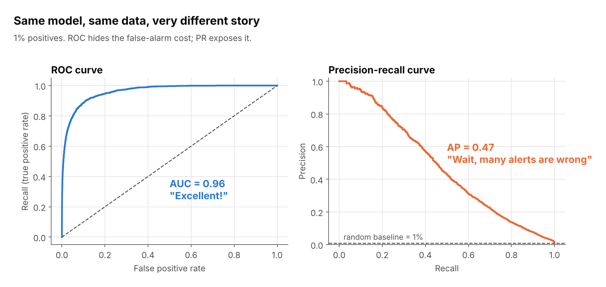

The cause is the denominator. ROC uses the false positive rate, FP / (FP + TN). With 9,900 negatives in the denominator, many false alarms still give a small rate. Precision has no such cushion.

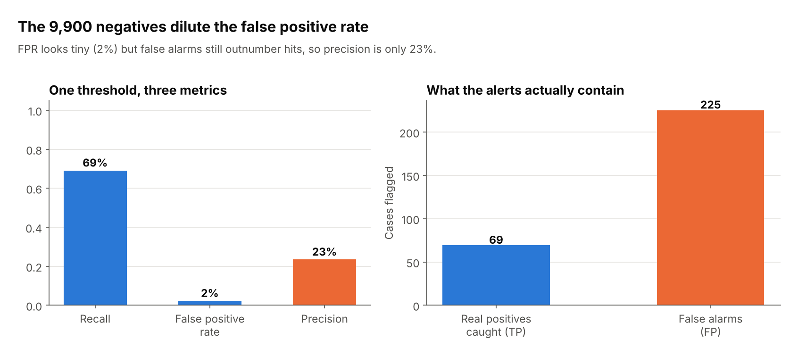

At this one threshold, the FPR is only 2%, but 225 false alarms are mixed in with 69 real hits, so only 23% of alerts are correct.

*Script: [`fig01_roc_vs_pr.py`](scripts/fig01_roc_vs_pr.py), [`fig02_why_roc_hides_fp.py`](scripts/fig02_why_roc_hides_fp.py)*

---

## 2. The baseline is the prevalence, not 0.5

A random classifier draws a horizontal line at precision = positive rate. The three curves below come from classifiers of identical quality; only the class balance differs.

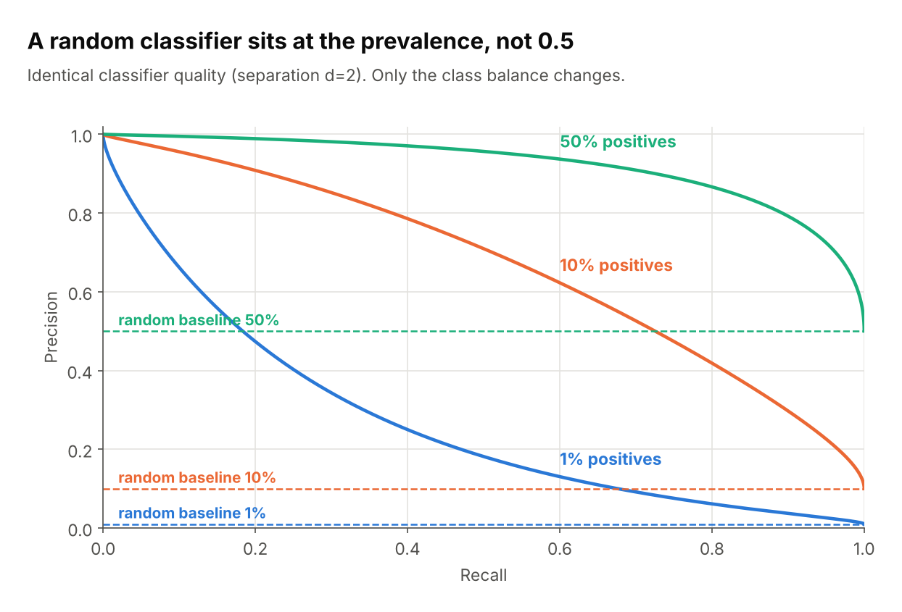

So a precision of 0.30 can be a strong result at 1% prevalence (30x chance) and a poor one at 50%. Always draw the baseline on your plot, and judge the curve by how far it sits above it.

*Script: [`fig03_baseline.py`](scripts/fig03_baseline.py)*

---

## 3. Reading the shape

Top-right is best. The shape tells you what trade-off you're facing.

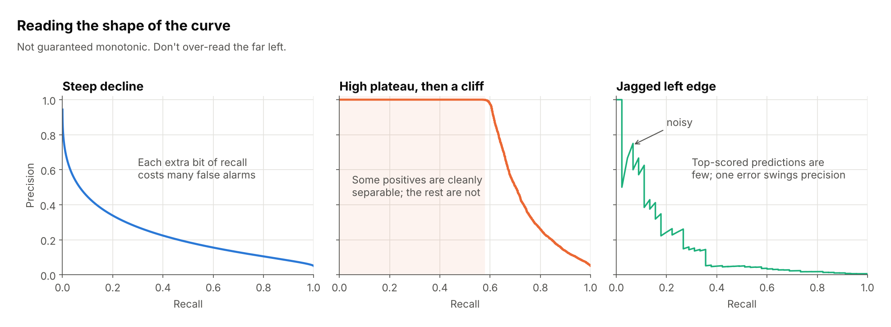

- **Steep decline:** every extra bit of recall costs many false alarms. Typical for hard problems.
- **High plateau, then a cliff:** a subset of positives is separated cleanly, so high-precision, low-recall use cases are feasible.
- **Jagged left edge:** at very high thresholds only a few predictions are being judged, so a single mistake swings precision. Don't over-read this region.

The curve is not guaranteed to be monotonic, unlike ROC.

*Script: [`fig04_curve_shapes.py`](scripts/fig04_curve_shapes.py)*

---

## 4. Summarising with average precision (AP)

AP is the area under the PR curve, computed as a step-wise sum (`sklearn.metrics.average_precision_score`).

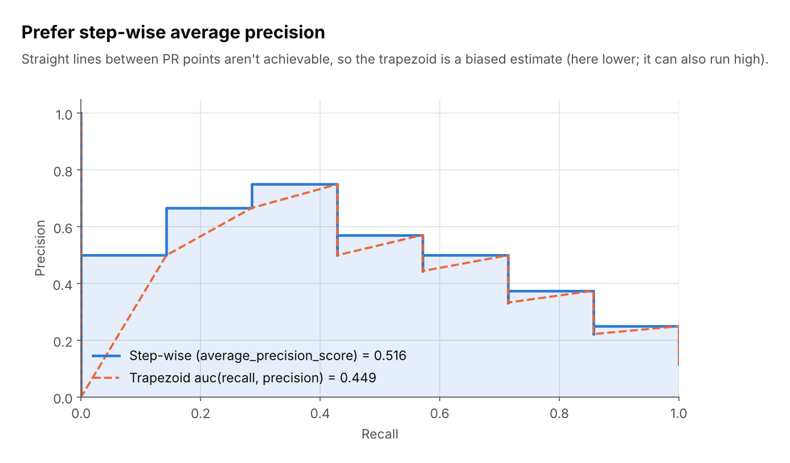

Linear interpolation between PR points (`auc(recall, precision)`) describes operating points you can't actually reach, so it's a biased estimate. The scikit-learn docs warn it can be too optimistic. In this small example it comes out lower (0.449 vs 0.516), so the safe summary is: prefer the step-wise version and don't treat the two as interchangeable.

Also remember that AP is only meaningful relative to prevalence. An AP of 0.20 is excellent at 1% prevalence and mediocre at 30%, and APs aren't comparable across datasets with different balance.

*Script: [`fig05_ap_vs_trapezoid.py`](scripts/fig05_ap_vs_trapezoid.py)*

---

## 5. Picking a threshold

1. Decide what matters operationally: a minimum recall, or a minimum precision.
2. Find that point on the curve and read off the threshold.
3. Check the other axis. If it's unacceptable, you need a better model or a relaxed constraint, not a different threshold.
4. Choose the threshold on a validation set; report on a held-out test set.

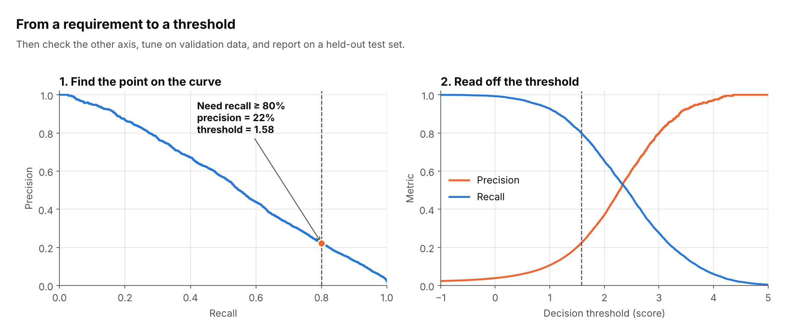

Here, requiring 80% recall at 2% prevalence forces a threshold of about 1.58 and leaves precision at about 22%.

*Script: [`fig06_threshold_picking.py`](scripts/fig06_threshold_picking.py)*

---

## 6. Worked example: what two operating points mean

Same model (2% prevalence), two thresholds, shown as alerts per 1,000 cases.

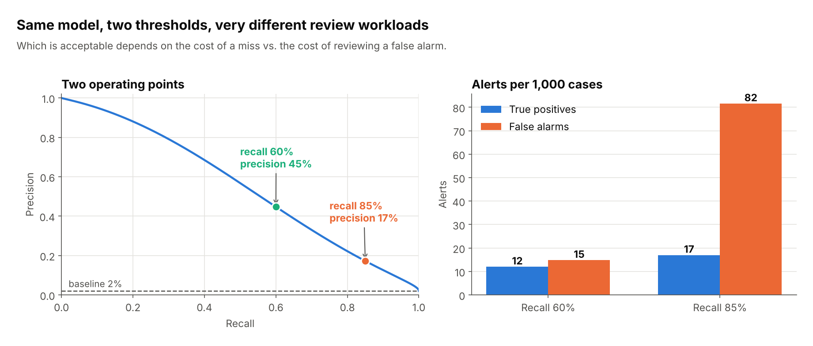

At 60% recall you review about 27 alerts and 12 are real. At 85% recall you catch 5 more real positives but review about 99 alerts. Whether that's worth it depends on the cost of a miss versus the cost of reviewing a false alarm. The curve helps you make that call, which a single AUC cannot.

*Script: [`fig11_worked_example.py`](scripts/fig11_worked_example.py)*

---

## 7. Pitfalls

### Prevalence shift

Precision depends on class balance; recall doesn't. If production prevalence differs from your evaluation set (for example, because you undersampled negatives), recompute or reweight precision using the true prior.

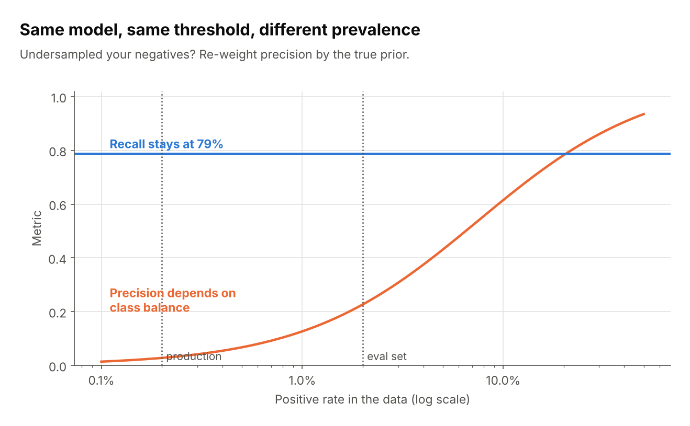

The same model and threshold has 79% recall everywhere, but precision is about 23% at 2% prevalence and about 3% at 0.2%.

*Script: [`fig07_prevalence_shift.py`](scripts/fig07_prevalence_shift.py)*

### Resampling distorts probabilities

A common way to deal with class imbalance is to rebalance the training data. The Synthetic Minority Over-sampling Technique (SMOTE) oversamples the rare class by creating synthetic cases, each placed at a random point on the line between a minority case and one of its nearest minority-class neighbours [@chawlaSMOTESyntheticMinority2002]. Undersampling does the opposite by discarding some of the abundant class. Either way, the training data no longer has the natural class distribution. This shifts the model's predicted probabilities, so thresholds chosen on a resampled validation set won't transfer.

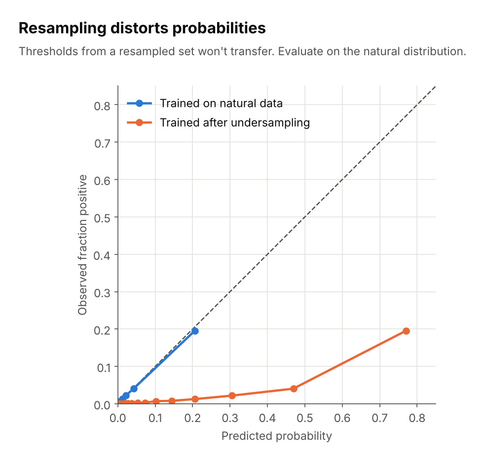

After undersampling negatives, the model predicts 0.77 for a group of cases of which only about 20% are positive. Evaluate on data with the natural class distribution.

*Script: [`fig08_resampling_calibration.py`](scripts/fig08_resampling_calibration.py)*

### Small positive counts

With few positives the curve is noisy. Use cross-validation or bootstrap bands, and report how many positives you have.

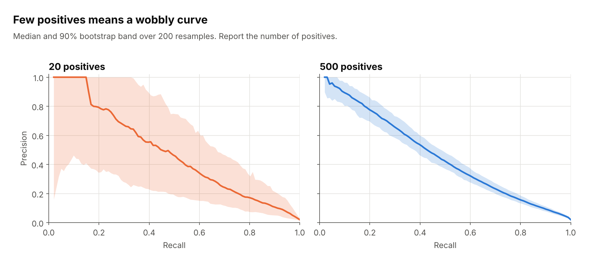

*Script: [`fig09_small_sample_noise.py`](scripts/fig09_small_sample_noise.py)*

### Comparing models

A curve that dominates another everywhere is clearly better. When curves cross, the better model depends on which recall range you care about, and a single AP number hides that.

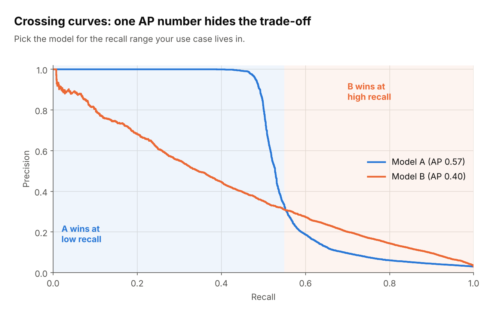

*Script: [`fig10_model_comparison.py`](scripts/fig10_model_comparison.py)*

## Resources

- Accuracy vs. precision vs. recall in machine learning: what's the difference?. [Link](https://www.evidentlyai.com/classification-metrics/accuracy-precision-recall)
- Precision and recall at K in ranking and recommendations. [Link](https://www.evidentlyai.com/ranking-metrics/precision-recall-at-k)
- Classification: Accuracy, recall, precision, and related metrics by Google Machine Learning for Engineers. [Link](https://developers.google.com/machine-learning/crash-course/classification/accuracy-precision-recall)
- Accuracy vs. Precision vs. Recall in Machine Learning: What is the Difference? by Encord. [Link](https://encord.com/blog/classification-metrics-accuracy-precision-recall/)
- Animations with receiver operating characteristic and precision-recall curves by Dariya Sydykova. [Link](https://github.com/dariyasydykova/open_projects/tree/master)
- ROC vs precision-and-recall curves on Cross Validated. [Link](https://stats.stackexchange.com/questions/7207/roc-vs-precision-and-recall-curves)
- The Relationship Between Precision-Recall and ROC Curves. [Link](https://mark.goadrich.com/articles/davisgoadrichcamera2.pdf)

## References

::: {#refs}
:::

## License

MIT. See [LICENSE](LICENSE).

## Credit

This article was generated with Claude, with the author's oversight and guidance.
